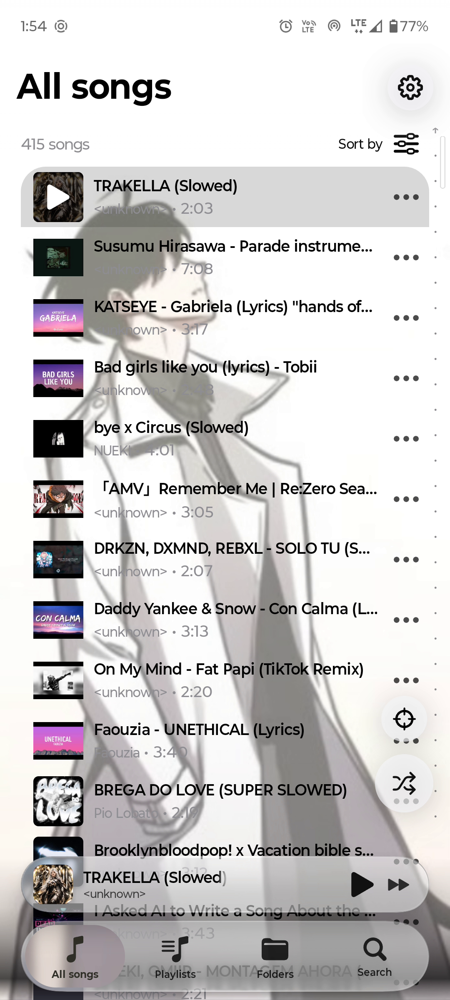
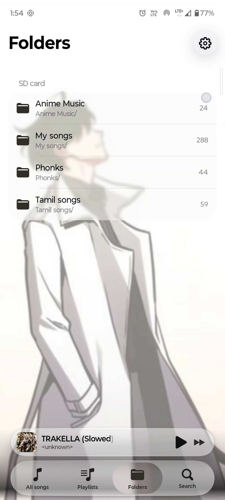
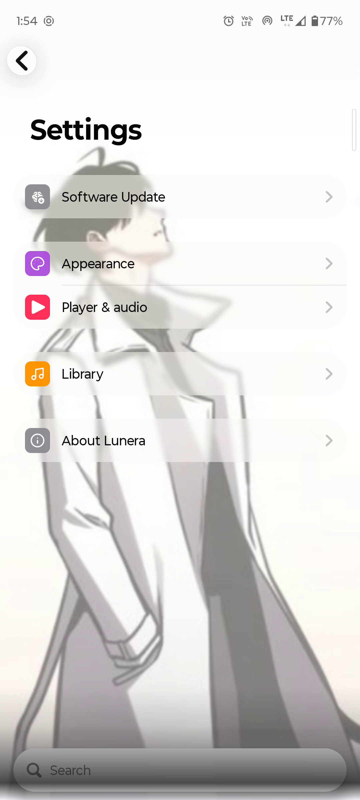

<div align="center">


# Lunera

**Local music for Android.**

Your songs, folders, lyrics and playback controls in one place.

<a href="https://github.com/Grimmoir-Organization/Lunera/releases"></a>
<a href="LICENSE"></a>

A **Grimmoir Organization** project.

[Downloads](#downloads) · [Screenshots](#screenshots) · [Features](#features) · [Build](#build) · [Support](#support)

</div>

---

## About

Lunera is a local Android music player. Browse your music folders, search for a song, manage your queue, read lyrics and set a sleep timer. This repository contains the regular application's source, documentation and release history.

[Lunera Lite](https://github.com/Grimmoir-Organization/Lunera-Lite) is a separately planned edition for older Android devices. Its features are still being selected.

## Downloads

**[Open Lunera releases →](https://github.com/Grimmoir-Organization/Lunera/releases)**

| Edition | Version prepared here | Android support |
| --- | --- | --- |
| Regular Lunera | 1.8.3 — rollback baseline | Android 8.0 and newer |

The release-upload bundle includes the original signed **Lunera-1.8.3.apk** and matching source archive. Downloads appear on GitHub after the release is published.

**Known issue:** 1.8.3 contains the previously reported notification-X crash on Android 15. It is the requested rollback baseline, not a new fix. See [rollback notes](docs/ROLLBACK.md).

Android normally blocks installing this older version over 1.8.4. Export any app data you need before considering an uninstall; uninstalling clears private app data.

## Screenshots

<table>
<tr><th>Your songs</th><th>Your folders</th><th>Your settings</th></tr>
<tr>
<td></td>
<td></td>
<td></td>
</tr>
</table>

<sub>Real captures from an earlier Lunera 1.8.2 development recording with a custom background. Layout may differ by version. See [asset sources](ASSET_SOURCES.md).</sub>

## Features

- Local music scanning, selected folders and subfolders.
- Search, sorting, favourites and playlists.
- Focus and highlight for the current or last-played song.
- Playback queue, shuffle, repeat, seeking and saved playback state.
- Background audio, headset handling and media-notification controls.
- Sleep timer: stop after a duration, at song end, or after a duration followed by the current song's end.
- Lyrics display, local import, manual correction and synchronized highlighting.
- Artwork display/editing, custom backgrounds, light/dark appearance and player layouts.
- Playback speed/pitch, audio settings and song-transition options.

Feature availability and known limitations are described in release notes. This README does not claim every feature has been validated on every device.

## Installation

1. Open [Releases](https://github.com/Grimmoir-Organization/Lunera/releases).
2. Download the APK attached to the selected release.
3. Open it and allow installation from your browser/file manager if prompted.
4. Grant audio access or choose your music folders.

For future updates, use the same package and signing key with a higher versionCode. The 1.8.3 rollback has a lower versionCode than 1.8.4; its original APK cannot be treated as an in-place upgrade.

## Build

Use JDK 21, the Gradle 9.8.2 wrapper, SDK Platform 37.0 / Build Tools 37.0.0, and Platform 36 / Build Tools 36.0.0 for shared modules. Configure your private SDK path and existing signing identity outside Git.

```powershell
.\gradlew.bat :app:testUniversalFossDebugUnitTest
.\gradlew.bat :app:assembleUniversalFossRelease
```

On Linux/macOS use `./gradlew` instead. Release output is under `app/build/outputs/apk/universalFoss/release/`.

All required Gradle modules, resources, schemas and tests remain included. Old report exports, build outputs, APKs, caches and private signing/configuration files are excluded from the repository ZIP.

## Source and releases

Use a tag such as **v1.8.3** in this repository. GitHub generates Source code ZIP and tar.gz archives for a release tag; upload the signed APK separately. A matching manually prepared source archive is also provided in the release bundle.

See [publishing instructions](docs/PUBLISHING.md). The existing regular updater points to `Grimmoir-Organization/Lunera`; a separate Lite release must use its own repository.

## Support

[Report an issue](https://github.com/Grimmoir-Organization/Lunera/issues/new) with your app version, Android version, phone model, reproduction steps and any crash report.

## License and credits

Distributed under the **GNU General Public License v3.0**. See [LICENSE](LICENSE), [NOTICE](NOTICE) and [UPSTREAM_NOTICE](UPSTREAM_NOTICE).

Lunera is based on [Convx](https://github.com/cosmictaserdev-creator/Convx). Existing upstream credits and contributor notices are preserved. Third-party artwork visible in screenshots belongs to its respective owners.

Maintained within [Grimmoir Organization](https://github.com/Grimmoir-Organization).
